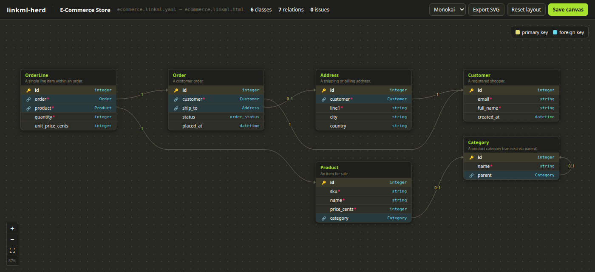

# linkml-herd

**HTML + ERD = HERD.** Render a **[LinkML](https://linkml.io/) schema as an ER
diagram** in a single, static HTML file you can rearrange and save — or as an
SVG image.



Point it at a LinkML schema and linkml-herd draws an entity-relationship diagram —
one table per class, columns from slots, and edges for the foreign-key
relationships implied by slots whose range is another class. The output is one
self-contained `.html` file you can open locally, commit, or host anywhere. The
diagram is plain HTML + SVG; a small inline script turns it into an infinite
canvas you can pan, zoom and rearrange.

Same idea as [dbml](https://dbml.dbdiagram.io/), except **LinkML is the source
of truth** — no custom DSL.

linkml-herd is an independent project, not part of or endorsed by the LinkML
project. (LinkML's own `gen-erdiagram` writes Mermaid ER diagrams; linkml-herd
gives you an editable canvas whose layout survives schema changes.)

## Install

Requires Python 3.11+.

```bash
uv tool install linkml-herd   # or: pipx install linkml-herd
```

From a checkout, `uv tool install .` does the same, or prefix the commands
below with `uv run`.

## Usage

```bash
linkml-herd mydb.yaml               # writes mydb.html next to the schema
linkml-herd mydb.yaml -o out.html   # choose the output path
linkml-herd mydb.yaml -o -          # write to stdout
linkml-herd mydb.yaml --open        # also open it in a browser
linkml-herd mydb.yaml --theme nord  # pick a colour theme
linkml-herd mydb.yaml --svg         # write mydb.svg instead (also: -o diagram.svg)
```

`--svg` draws the same diagram as a standalone SVG image (plain shapes and
text, no scripts or CSS) for docs and slides. It uses the canvas layout and
theme saved in `mydb.html` when that page exists, without changing it; `--layout`,
`--relayout` and `--theme` work as for the page. The page's **Export SVG** button
does the same from the browser, with the current layout and the theme on screen.

Themes: `monokai` (default), `auto` (light or dark following your OS),
`light`, `dark`, `dracula`, `nord`, `solarized`. The theme is stored in the page, so
later runs keep it until you pass another `--theme`. Viewers can switch theme
from the menu in the top bar; that choice is remembered in their browser for
that page and is not written into saved files. Themes are the
`:root[data-theme="…"]` blocks in `src/linkml_herd/static/themes.css` — add a
block there to add a theme.

Schema problems (e.g. a slot whose range is an unknown class) are printed to
stderr and listed at the top of the page; the affected columns are highlighted.

## Editing the canvas

Drag the background to pan, scroll (or pinch) to zoom, and use the controls in
the bottom-left to zoom or fit everything in view. Drag tables to rearrange
them, then click **Save canvas** in the top bar. The page writes itself back
out with your layout embedded:

- **Chromium-based browsers** open a save dialog the first time — browsers
  can't start it in the page's own folder, so navigate to `mydb.html` once and
  overwrite it. The browser then remembers that file for this page, and later
  saves (even after a restart) write straight back to it, at most asking you to
  allow editing.
- **Other browsers** download a copy, which you move over the original or point
  `linkml-herd --layout` at (below).

The HTML file _is_ the layout store. Re-running `linkml-herd mydb.yaml` reads the layout
saved in `mydb.html` before overwriting it, so editing the schema never undoes
your canvas:

- tables you placed stay where they are;
- tables new to the schema are placed below the existing ones;
- tables removed from the schema simply disappear.

```bash
linkml-herd mydb.yaml --layout ~/Downloads/mydb.html   # take the layout from another copy
linkml-herd mydb.yaml --relayout                       # discard it and lay out from scratch
```

**Reset layout** in the page does the same as `--relayout` once saved.

Until you save a layout, tables are placed automatically in columns by
foreign-key depth: a table sits to the left of every table it references, so
edges flow left to right, and edges that skip a column are routed through a
reserved lane rather than under other tables.

## Development

```bash
uv run pytest
```

| Concern                  | Module                              |
| ------------------------ | ----------------------------------- |
| Parse LinkML → ER model  | `src/linkml_herd/parse.py`          |
| Layout + HTML/SVG        | `src/linkml_herd/render.py`         |
| Page styles / themes     | `src/linkml_herd/static/style.css`, `themes.css` |
| Pan / zoom / drag / save | `src/linkml_herd/static/canvas.js`  |
| `linkml-herd` command    | `src/linkml_herd/cli.py`            |

Edge routing exists twice — `edge_path` in `render.py` and `edgePath` in
`canvas.js` — so edges redrawn while dragging match what `linkml-herd` emits;
keep them in step.

### LinkML subset supported

`classes` with inline `attributes` and/or referenced top-level `slots`,
reusable `slots`, `slot_usage` overrides, `is_a` / `mixins` inheritance, and
`imports` (slots/classes/types/enums pulled from sibling files, resolved
relative to the importing file). Attributes and slots are interchangeable. A
slot is treated as a **foreign key** when its `range` matches another class
name; `identifier: true` (or `key: true`) marks the **primary key**.

Equivalence across these representations is locked down by `tests/fixtures/` —
every variant of the ecommerce schema must produce the same diagram (see that
folder's README).

## Issue tracking

This repo uses [Seeds](https://github.com/jayminwest/seeds) (`sd`) for git-native
issue tracking. Run `sd prime` for the workflow, `sd ready` to find work.
