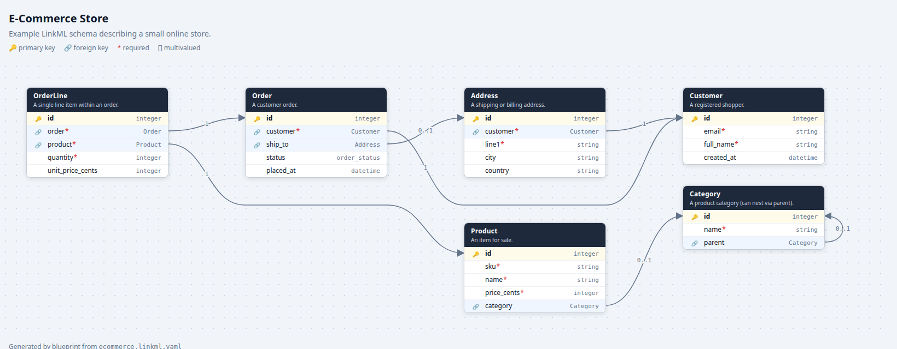

# blueprint

Render a **[LinkML](https://linkml.io/) schema as an ER diagram** in a single,
static HTML file.



Point it at a LinkML schema and blueprint draws an entity-relationship diagram —
one table per class, columns from slots, and edges for the foreign-key
relationships implied by slots whose range is another class. The output is one
self-contained `.html` file (inline CSS + SVG, no JavaScript) you can open
locally, commit, or host anywhere.

Same idea as [dbml](https://dbml.dbdiagram.io/), except **LinkML is the source
of truth** — no custom DSL.

## Usage

Requires Python 3.11+ and [uv](https://docs.astral.sh/uv/).

```bash
uv run bp mydb.yaml              # writes mydb.html next to the schema
uv run bp mydb.yaml -o out.html  # choose the output path
uv run bp mydb.yaml -o -         # write to stdout
uv run bp mydb.yaml --open       # also open it in a browser
```

To put `bp` on your PATH: `uv tool install .`

Schema problems (e.g. a slot whose range is an unknown class) are printed to
stderr and listed at the top of the page; the affected columns are highlighted.

## Layout

Tables are laid out automatically in columns by foreign-key depth: a table
sits to the left of every table it references, so edges flow left to right.
Edges that skip a column are routed through a reserved lane rather than under
other tables. There is no layout file — re-run `bp` after editing the schema.

## Development

```bash
uv run pytest
```

| Concern                 | Module                    |
| ----------------------- | ------------------------- |
| Parse LinkML → ER model | `src/blueprint/parse.py`  |
| Layout + HTML/SVG       | `src/blueprint/render.py` |
| `bp` command            | `src/blueprint/cli.py`    |

### LinkML subset supported

`classes` with inline `attributes` and/or referenced top-level `slots`,
reusable `slots`, `slot_usage` overrides, `is_a` / `mixins` inheritance, and
`imports` (slots/classes/types/enums pulled from sibling files, resolved
relative to the importing file). Attributes and slots are interchangeable. A
slot is treated as a **foreign key** when its `range` matches another class
name; `identifier: true` (or `key: true`) marks the **primary key**.

Equivalence across these representations is locked down by `tests/fixtures/` —
every variant of the ecommerce schema must produce the same diagram (see that
folder's README).

## Issue tracking

This repo uses [Seeds](https://github.com/jayminwest/seeds) (`sd`) for git-native
issue tracking. Run `sd prime` for the workflow, `sd ready` to find work.
